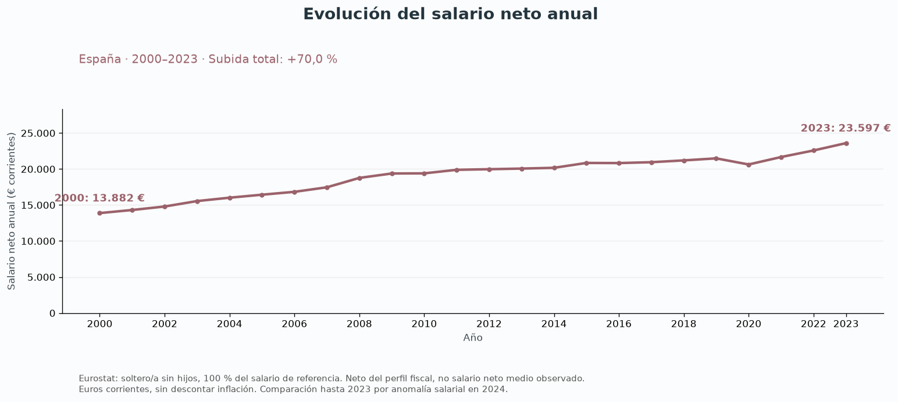
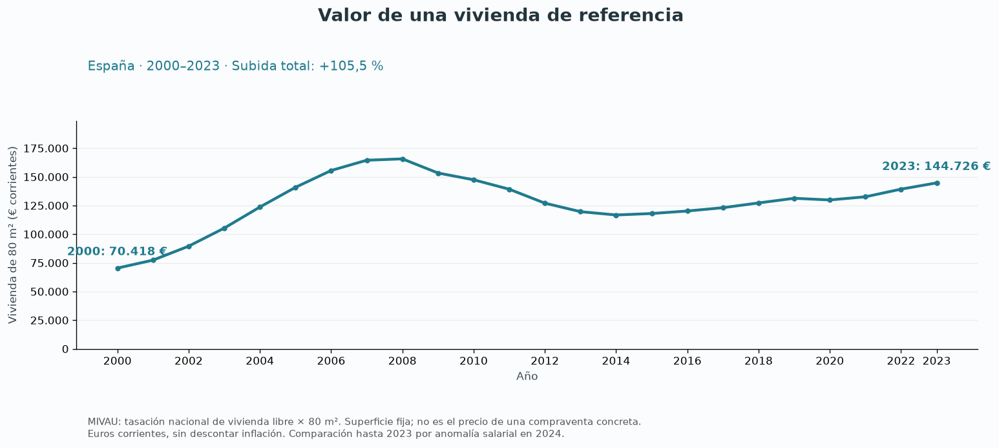
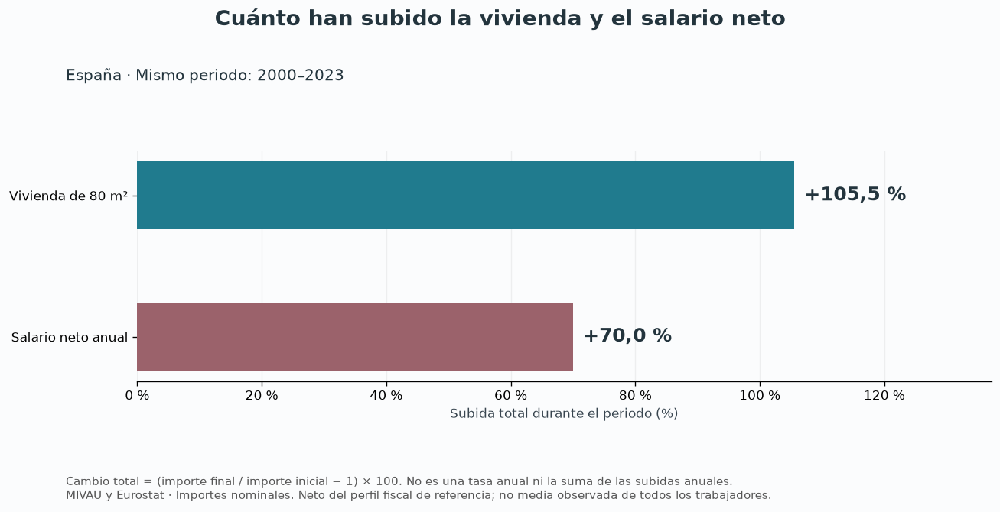
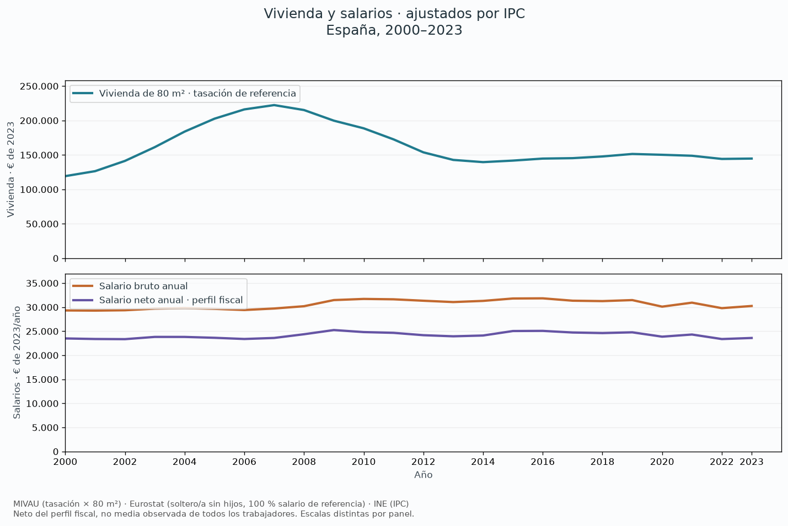
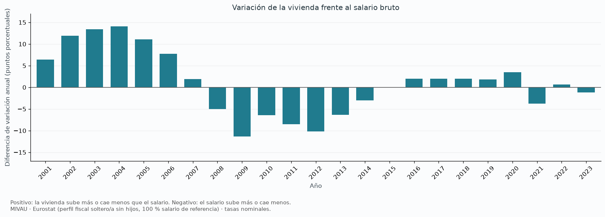
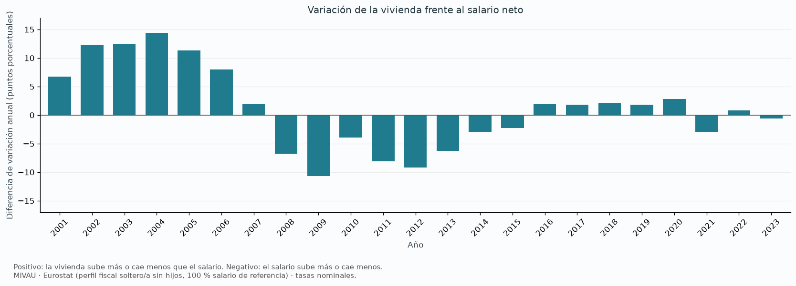

# Vivienda y salarios bruto y neto en España, 2000–2023

La vivienda es una tasación nacional MIVAU multiplicada por **80 m²**, un supuesto
fijo de superficie, no el tamaño medio ni el importe de una compraventa.
Bruto y neto proceden de [Eurostat, earn_nt_net](https://ec.europa.eu/eurostat/databrowser/view/earn_nt_net/default/table?lang=en):
España, euros, persona soltera sin hijos al 100 % del salario de referencia.
El neto incorpora impuestos y cotizaciones de ese perfil; no es el neto medio
observado de todos los trabajadores. No se mezcla esta fuente con INE EAES.

## Importes y cambios acumulados

Las dos primeras figuras muestran por separado el salario neto anual y el valor
de la vivienda, en euros corrientes. La tercera compara sus subidas totales
durante el mismo periodo, sin descontar inflación.
La tabla siguiente conserva también el bruto y los cambios ajustados por IPC.

| Serie | Cambio nominal 2000–2023 | Cambio descontado IPC |
| --- | ---: | ---: |
| Vivienda de 80 m² | +105.52 % | +21.40 % |
| Salario bruto anual | +74.66 % | +3.17 % |
| Salario neto anual · perfil fiscal | +69.99 % | +0.41 % |

## Diferencia de variación anual

Una barra por año, mismo color y escala: **tasa de vivienda menos tasa salarial**,
en puntos porcentuales. Cada tasa es (valor actual / valor anterior − 1) × 100.
Las barras cubren 2001–2023; el primer año solo sirve para calcular la tasa.
Una barra positiva indica que vivienda sube más o cae menos; una negativa,
que el salario sube más o cae menos. No es el porcentaje de cambio del cociente.

## Cobertura y reproducción

Se conserva la respuesta original en `data/snapshots/block01/salary_eurostat.json`
y la política de comparación y huella SHA-256 en `salary_eurostat_source.json`.
2024 está marcado como ruptura y contiene importes anómalos; se excluye junto a
2025, sin extrapolar ni encadenar a través de la ruptura. El snapshot EAES y su
script de normalización se conservan como fuente alternativa, no usada aquí.

`python scripts/run_block01.py` reproduce las siete figuras, este informe y las
tablas `housing_salary_comparison.csv` y `housing_salary_variation_gap.csv`, sin red.
El notebook utiliza las mismas funciones de `src/spain_housing/salary_analysis.py`.
La comparación no mide por sí sola accesibilidad: faltan ingresos del hogar,
gastos, ahorro, financiación y diferencias territoriales; no identifica causas.
