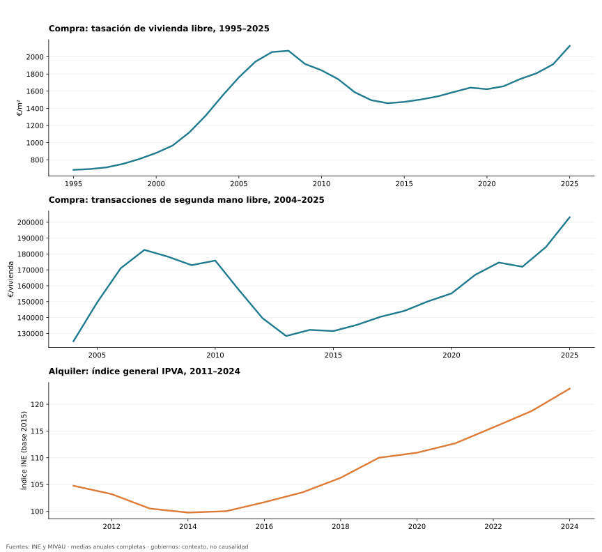
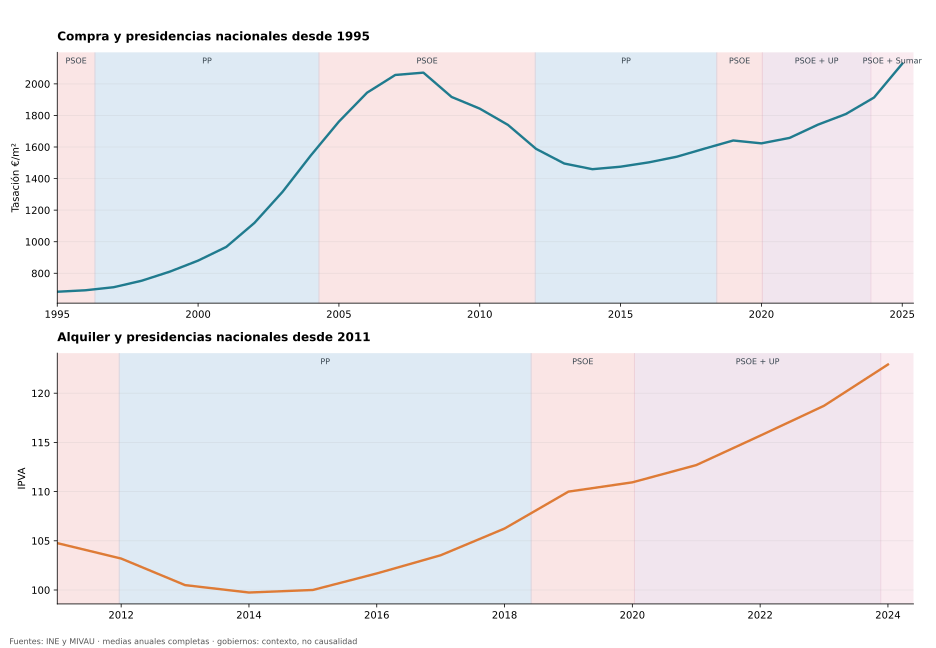
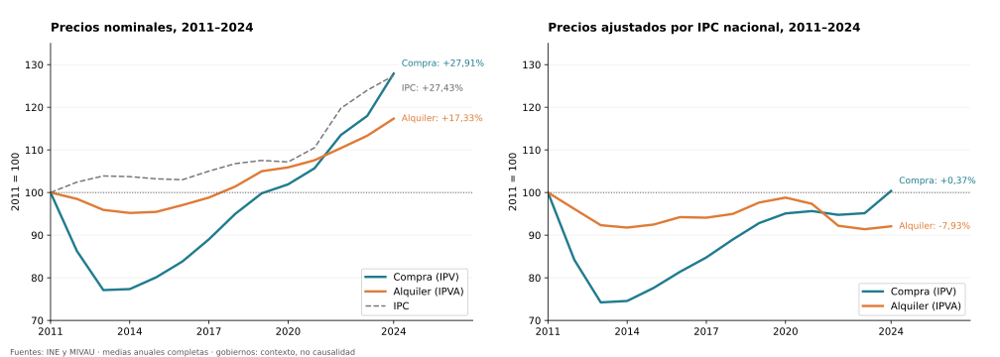
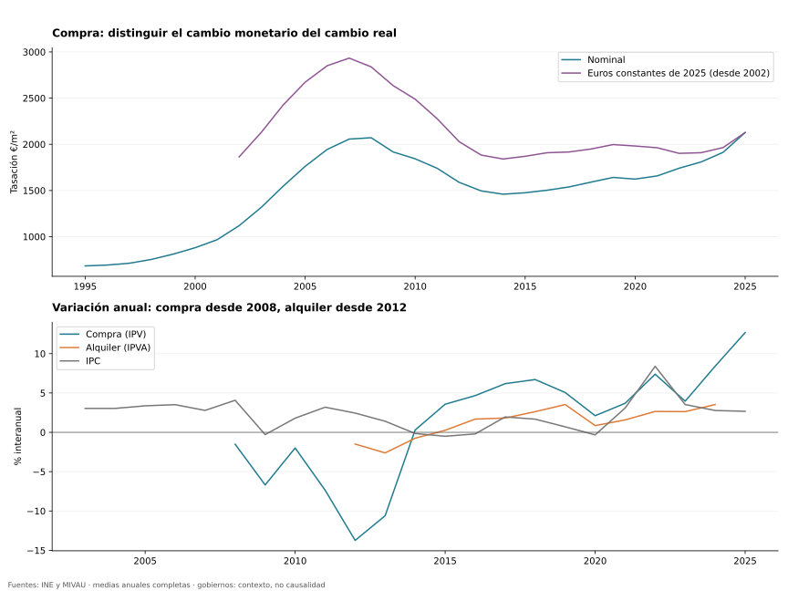
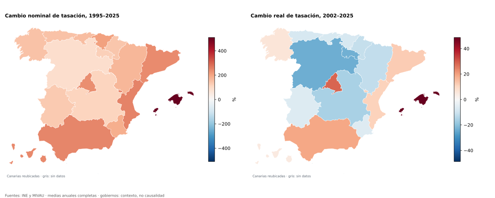
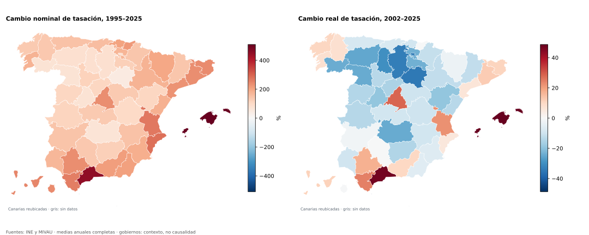
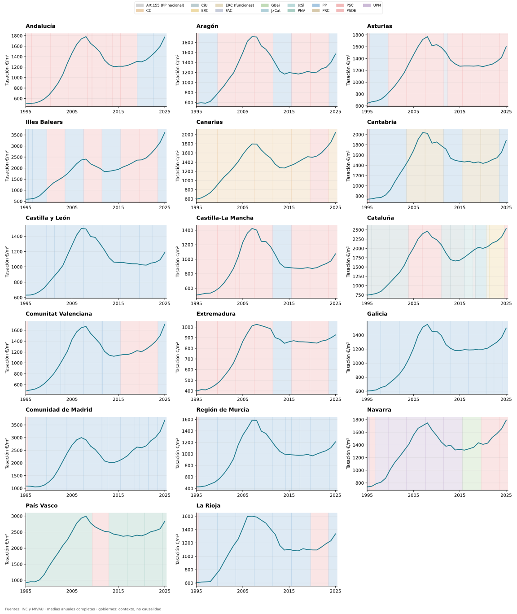
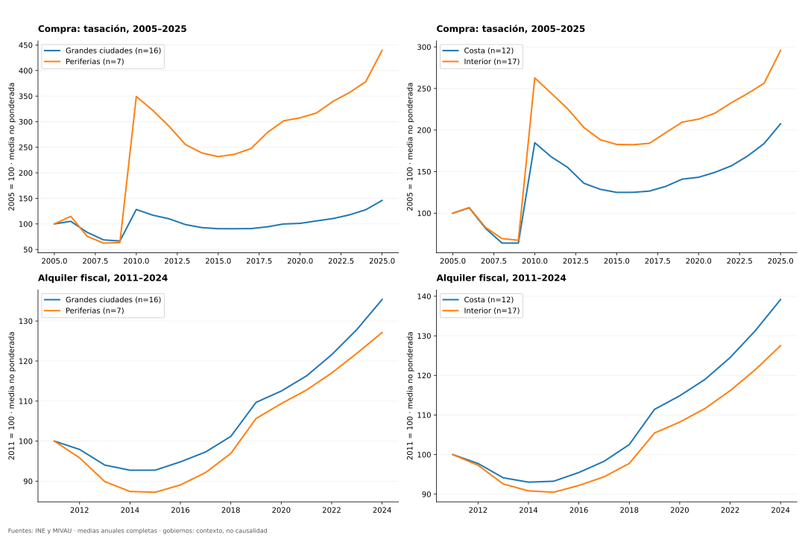

# Bloque 1: perspectiva histórica ampliada

[**Perspectiva nacional más larga con horizonte desde 1950**](block_01_since_1950.md).
Este informe conserva las series territoriales y el IPVA desde 2011.

La serie de compra por tasación empieza en **1995**, las transacciones por vivienda en **2004**,
el IPV en **2007** y el alquiler general IPVA en **2011**. Se usan años completos: compra
hasta **2025** y alquiler hasta **2024**. Los trimestres de 2026 quedan fuera de las medias anuales.

## Evolución nacional y contexto político

Las medidas conservan sus definiciones: tasación de vivienda libre por m², importe medio de
transacciones de segunda mano libre por vivienda e índice fiscal de alquiler. No hay una serie
nacional comparable de alquiler en €/vivienda desde 1995; no se inventa agregando medianas locales.

Las franjas identifican presidencias o gabinetes nacionales
y el partido de la presidencia autonómica.
La coincidencia temporal no estima efectos causales.
La tabla por gobierno excluye años de transición,
expone la duración y anualiza el cambio; los periodos sin dos años completos quedan sin resultado.
Se conservan intervalos históricos del Senado; pueden existir interinidades breves no detalladas.

## Ventana común de compra y alquiler: 2011–2024

| Medida nacional | Cambio nominal | Cambio real |
| --- | ---: | ---: |
| Compra, IPV | +27.91% | +0.37% |
| Alquiler, IPVA general | +17.33% | -7.93% |

IPC nacional: **+27.43%**. Ambos precios usan
el mismo año inicial y final.
La ventana reciente 2021–2024 y el desglose por antigüedad de contrato se conservan en el
[informe inicial](block_01_prices.md). No se comparan porcentajes
de ventanas distintas.

Ambos paneles usan exactamente la misma escala vertical (70–135), marcas y periodo.
La línea de 100 representa 2011; las etiquetas indican variaciones acumuladas desde ese año.

El IPC disponible en el snapshot comienza en **2002**: las series reales y sus tablas lo indican.
Los valores reales son euros de 2025 o índices relativos al año base especificado; deflactar no mide
accesibilidad económica, que requiere ingresos. Se utiliza IPC nacional también para territorios.

## Comunidades, provincias y municipios

Se generalizan los contornos y se omiten islotes menores de aproximadamente 1 km².
Los mapas comparan extremos fijos: 1995–2025 nominal y 2002–2025 real. Las tablas territoriales
indican primer y último dato, cobertura y años ausentes. También identifican máximo anterior a
la crisis **dentro de 1995–2008**, mínimo posterior **dentro de 2009–2015**, caída y recuperación.
Son extremos de ventanas explícitas, no fechas universales del ciclo de todos los territorios.

Compra municipal: **2005–2025**, selección de 30 casos. Alquiler fiscal por m² y por vivienda:
**2011–2024**, según cobertura. Los perfiles usan una muestra fija con todos los años observados,
media no ponderada de índices locales; el número de ciudades y su composición se publican.
Navarra y País Vasco mantienen sus fechas de inicio fiscal (2021 y 2024). Las tablas de alquiler
no asignan máximos anteriores a 2008 a series que empiezan después.

## Código y resultados reproducibles

- [Notebook con cálculos visibles y resultados](../notebooks/01b_price_history.ipynb).
- [Tablas históricas completas](tables/history/), incluidas cobertura, ciclos y presidencias.
- [Código del análisis](../src/spain_housing/price_history.py).
- [Fuentes originales y SHA-256](../data/snapshots/block01/source_manifest.json).

Ejecutar `python scripts/run_price_history.py` desde la raíz. No requiere descargar fuentes.
La ampliación del IPVA procede de la tabla INE 59056 (general por edificación), sin encadenar
porcentajes redondeados de notas de prensa ni extrapolar contratos nuevos hacia atrás.
