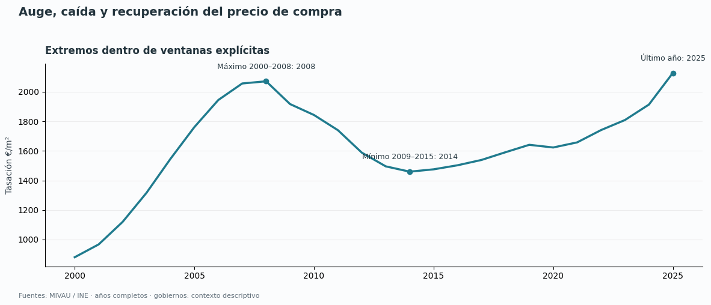

# Bloque 1 · Precio de compra de vivienda en España

## Alcance y medida principal

Analizamos la **tasación media de vivienda libre en €/m²**, desde **2000 hasta 2025**.
Es una medida de valoración, no el precio anunciado ni el precio efectivo de cada compraventa.
Todas las figuras de este bloque usan esta misma medida. Los importes por vivienda y el IPV
se conservan como fuentes originales, pero no se mezclan con la tasación.
Se utilizan medias de años completos; los trimestres de 2026 quedan fuera.

## 1. Evolución nacional desde 2000

La tasación pasó de **880.23 €/m²** en 2000 a **2127.57 €/m²** en 2025:
un cambio acumulado del **+141.71%**.

El máximo dentro de 2000–2008 corresponde a **2008** y el mínimo dentro de 2009–2015 a
**2014**. La caída entre ambos fue del **-29.53%** y la variación
desde el mínimo hasta 2025, del **+45.78%**.
Elegir el inicio o el final de un ciclo cambia la lectura del crecimiento acumulado.

## 2. Compra frente a los precios generales

Comparamos cuánto ha subido el precio de compra respecto a los precios generales, medidos
por el IPC. La ventana común es **2002–2025**, con **2002 = 100**: un valor de 120
representa una subida acumulada del 20 %, no un precio en euros.
La tasación aumentó **+90.11%** y los precios generales,
**+66.57%**. El IPC disponible empieza en 2002.
El IPC no indica si los ingresos han crecido al mismo ritmo: esta comparación no mide
la accesibilidad económica de comprar una vivienda.

## 3. Comunidades y provincias

Los mapas muestran el nivel de 2025 y el cambio con extremos fijos **2000–2025**.
Las tablas incluyen cobertura, años ausentes y extremos del ciclo de cada territorio.
El gris representa falta de datos; Canarias se reubica por legibilidad. Los contornos
son ilustrativos y conservan la atribución de las geometrías originales.

## 4. Municipios y perfiles territoriales

Los datos municipales empiezan en **2005** y llegan hasta **2025**. La selección
contiene 30 municipios y no representa todos los municipios de España. Los perfiles
comparan muestras fijas con todos los años observados: media no ponderada de índices
locales, base 2005 = 100. La composición está en `profile_fixed_samples.csv`.

## 5. Gobiernos como contexto temporal

Las franjas identifican presidencias nacionales y el partido de la presidencia autonómica,
no todos los socios del gabinete. Los puntos de precio se sitúan a mitad de año porque
representan medias anuales. La tabla de mandatos utiliza solo años completos dentro
de cada presidencia, excluye años de transición y muestra fechas, cobertura y tasas
anualizadas. Los periodos sin dos años observados no tienen tasa de cambio.
El gráfico de mandatos sitúa cada periodo por su año central, para que el contexto
temporal sea visible. No clasifica partidos ni atribuye los cambios a sus políticas.

## 6. Vivienda frente a salarios bruto y neto

Comparación Eurostat y MIVAU, 2002–2023: importes nominales, euros constantes de 2023
y diferencias de variación anual (2003–2023) en puntos porcentuales.
El neto corresponde al perfil fiscal de una persona soltera sin hijos al 100 % del
salario de referencia; no es el neto medio observado de todos los trabajadores.
2024 se excluye por ruptura y valores anómalos; no se encadena con 2025.

Ver [informe salarial y fuentes](block_01_housing_salary.md) para importes,
fórmula, cobertura e interpretación. El generador reproduce las 17 figuras del bloque.

## Fuentes y reproducción

- [Notebook principal con código y resultados](../notebooks/01_prices.ipynb).
- [Notebook de cobertura y mandatos](../notebooks/01b_price_history.ipynb).
- [Tablas descargables](tables/block01/).
- [Código del análisis](../src/spain_housing/prices_analysis.py).
- [Fuentes y huellas SHA-256](../data/snapshots/block01/source_manifest.json).

Ejecutar `python scripts/run_block01.py`. No necesita descargar datos.
