# Evolución de la vivienda en España: precios, territorio y contexto político

**Perspectiva histórica ampliada:** [compra desde 1995 y alquiler desde 2011](block_01_price_history.md).
Este informe conserva las ventanas iniciales y la comparación reciente.

**Análisis ejecutado con datos reales.** Publicaciones recuperadas el 6 de octubre de 2026.
Las series anuales de compraventa llegan a 2025; alquileres fiscales e IPVA, a 2024.
Los trimestres de 2026 se muestran únicamente en la serie trimestral de valor por vivienda.

## 1. Evolución nacional

En la ventana común **2021–2024**, el índice de compraventa (IPV) aumentó
**21.02%** y el índice de alquiler (IPVA), **9.07%**.
Desde 2007 hasta 2025, el IPV cambió **20.26%**;
su mínimo anual dentro de esa serie aparece en **2013**.
La trayectoria incluye caídas y recuperación: elegir únicamente un tramo ascendente
ocultaría parte de la historia. El valor tasado medio de 2024, calculado como media
simple de los cuatro trimestres, es **1,913.62 €/m²**.

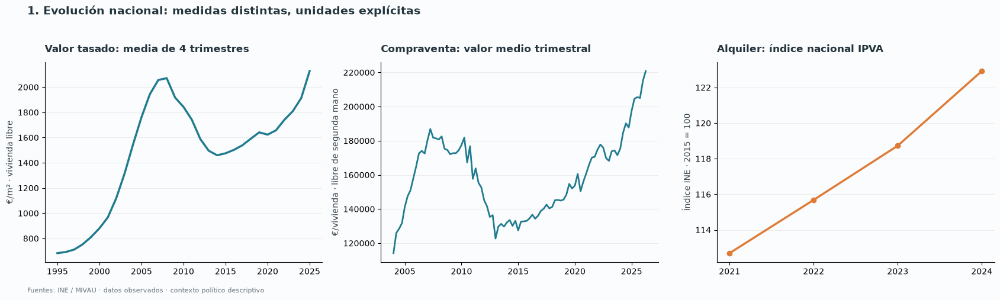
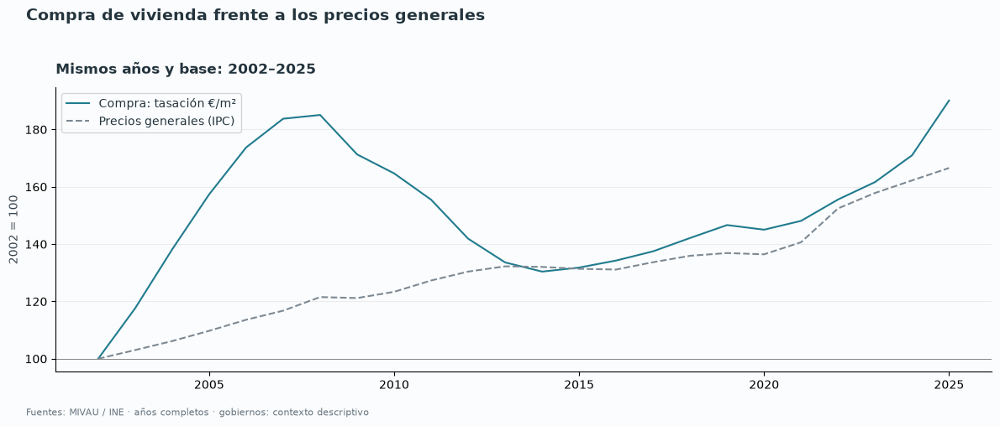
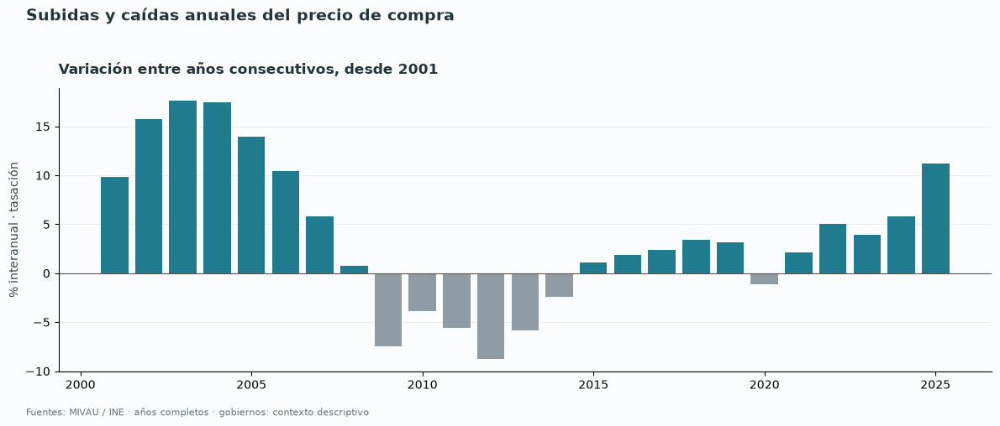

El valor de transacciones por vivienda corresponde a vivienda libre de segunda mano;
la tasación por m² y el IPV no miden exactamente el mismo universo. El IPVA es un
índice de alquileres, no euros por vivienda. No se ha fabricado una mediana nacional
en euros a partir de medianas regionales.

## 2. Gobiernos nacionales

Las franjas distinguen presidencias del PSOE y PP y las etapas de coalición nacional
PSOE–UP y PSOE–Sumar. Los puntos anuales se sitúan a mitad de año: representan medias
anuales, no una medición precisa el día del cambio de gobierno. Las caídas posteriores
a 2007 y la recuperación atraviesan distintas etapas políticas; el gráfico permite
localizar esas etapas, pero no identifica responsabilidad causal.

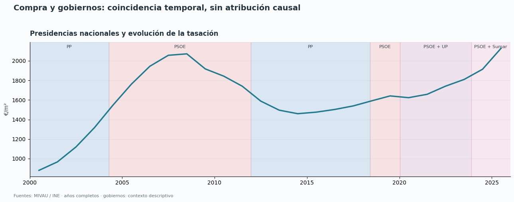

**Cambios entre años completos disponibles dentro de cada presidencia:**

| Presidencia | Contexto | Compra: años | IPV (%) | Alquiler: años | IPVA (%) |
| --- | --- | --- | --- | --- | --- |
| Zapatero | PSOE | 2007–2010 | -9.93 | Insuficiente | Sin datos |
| Rajoy | PP | 2012–2017 | 3.21 | Insuficiente | Sin datos |
| Sánchez | PSOE; coaliciones desde 2020 | 2019–2025 | 44.39 | 2021–2024 | 9.07 |

Los periodos tienen distinta duración y parten de momentos diferentes del ciclo.
Se agrupan las coaliciones de Sánchez bajo su presidencia en esta tabla, mientras
el gráfico conserva sus etapas. El alquiler no tiene observaciones comparables
para Zapatero o Rajoy en el IPVA recuperado: «insuficiente» no significa estabilidad.

## 3. Inflación y crecimiento real

Entre 2021 y 2024, el IPC general aumentó **15.33%**. Al descontarlo,
el cambio del IPV es **4.93%**, frente a
**-5.43%** para el IPVA. Estos cambios reales no miden
el esfuerzo de cada hogar: para eso se necesitan ingresos y gasto individuales.

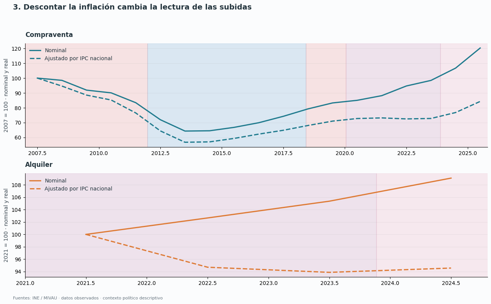

## 4. Grandes ciudades, periferias, costa e interior

Se comparan **30 municipios seleccionados de forma explícita**, usando una muestra
fija con observaciones en los 14 años 2011–2024. Cada municipio se rebasa a 2011=100
y recibe el mismo peso. Los grupos son descriptivos de esta muestra y **no son
estimaciones representativas de toda la costa o todas las periferias españolas**.
La categoría urbana y la costera son dimensiones separadas.

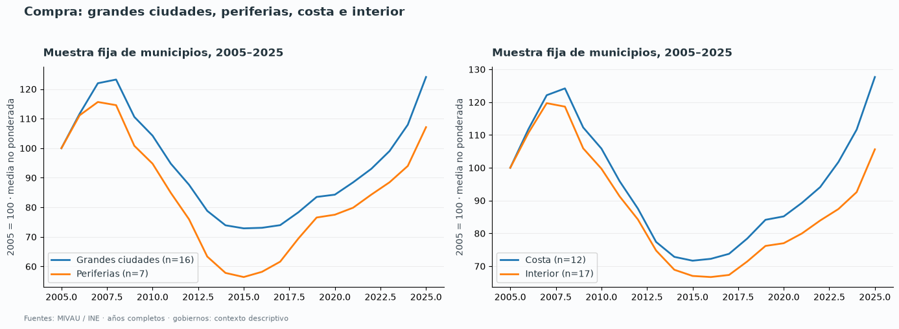

| Medida | Grupo de muestra | Municipios | Cambio 2011–2024 (%) |
| --- | --- | --- | --- |
| Tasación | Ciudades seleccionadas | 16 | 14.99 |
| Tasación | Periferias seleccionadas | 7 | 11.30 |
| Tasación | Costa seleccionada | 12 | 17.15 |
| Tasación | Interior seleccionado | 17 | 2.60 |
| Alquiler | Ciudades seleccionadas | 16 | 35.36 |
| Alquiler | Periferias seleccionadas | 7 | 27.12 |
| Alquiler | Costa seleccionada | 12 | 39.16 |
| Alquiler | Interior seleccionado | 17 | 27.52 |

## 5. Comunidades autónomas

Los mapas separan el precio de 2024 y el crecimiento 2011–2024. La cobertura del
alquiler fiscal de 2024 comprende las 17 comunidades más Ceuta y Melilla. **Navarra
solo aporta datos desde 2021 y País Vasco desde 2024**: aparecen en el mapa de niveles,
pero su crecimiento 2011–2024 queda en gris. No se extrapola la cobertura ausente.
Una región puede tener precios altos y crecimiento moderado, o precios inicialmente
bajos y una subida intensa: niveles y variaciones responden a preguntas distintas.

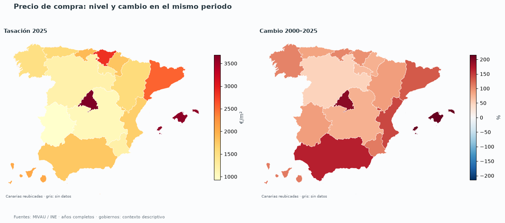
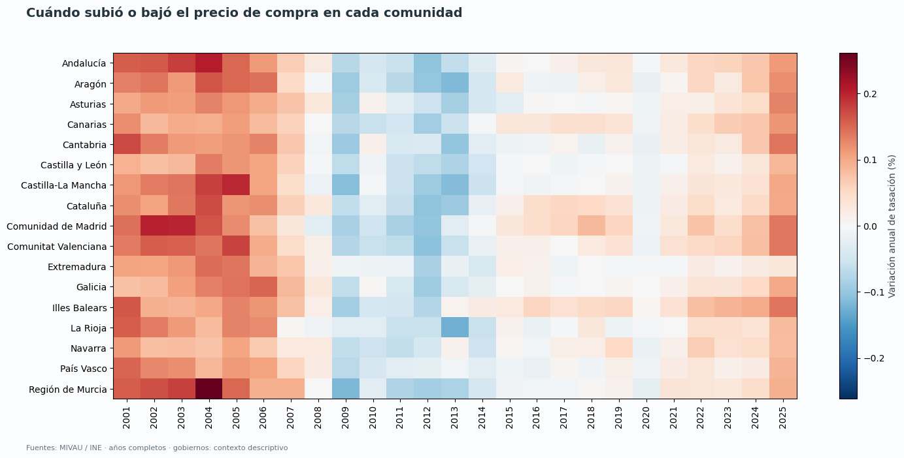

**Mayores medianas regionales de alquiler de la cobertura observada, 2024:**

| Territorio | €/m²/mes | Cambio 2011–2024 (%) |
| --- | --- | --- |
| Comunidad de Madrid | 12.12 | 26.89 |
| País Vasco | 10.09 | Sin datos |
| Cataluña | 9.84 | 31.00 |
| Illes Balears | 9.62 | 58.56 |
| Ceuta | 9.45 | 22.83 |

**Mayores crecimientos nominales de la mediana regional de alquiler:**

| Territorio | Cambio 2011–2024 (%) |
| --- | --- |
| Illes Balears | 58.56 |
| Comunitat Valenciana | 42.24 |
| Canarias | 39.47 |
| Andalucía | 34.50 |
| Melilla | 33.15 |

## 6. Gobiernos autonómicos

Se han incorporado presidencias de las **17 comunidades**, extraídas de los dosieres
del Senado y sus referencias a nombramientos oficiales. Las franjas regionales
muestran **la adscripción de la presidencia**, no la composición completa del gabinete.
Esto evita convertir un gobierno de coalición en un gobierno monocolor por omisión.
Cataluña identifica el periodo del artículo 155 y el intervalo de funciones posterior
a la inhabilitación de Torra. Las fechas se basan en nombramiento por real decreto;
pueden diferir unos días de la toma de posesión. Interinidades menores no quedan
completamente representadas por la lista de nombramientos y deben leerse con esa limitación.

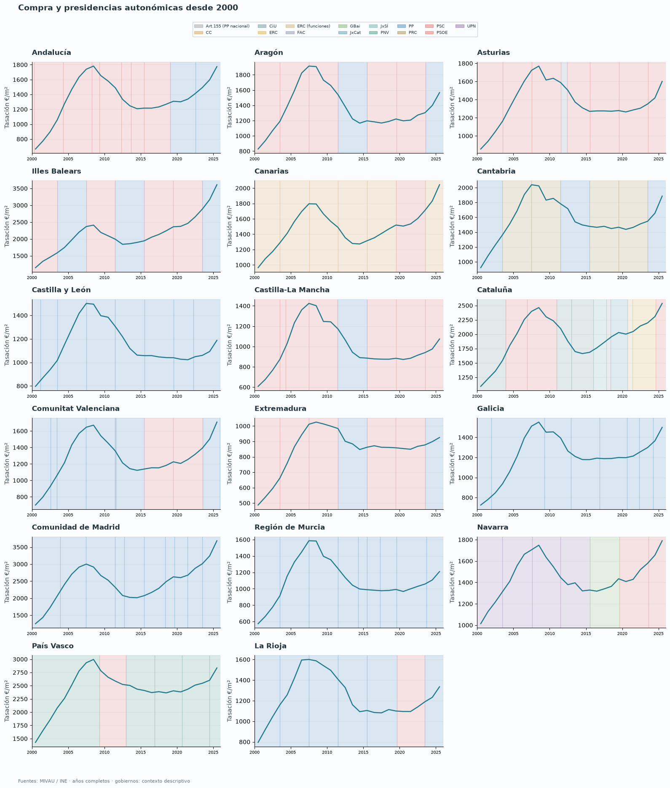
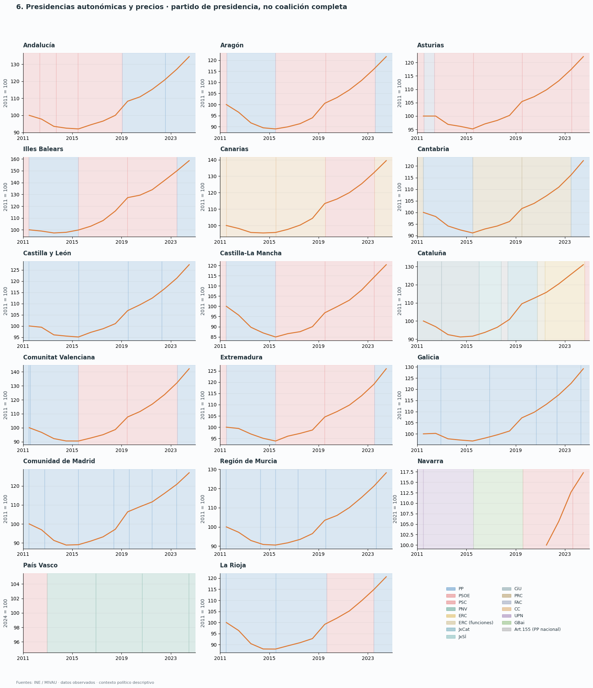

La tabla compara exclusivamente **años completos comunes dentro de cada intervalo**,
con al menos dos observaciones. De 97 intervalos regionales registrados,
**43** permiten comparar ambas medidas. En ellos hay **32** periodos
con subida del IPV y **11** con bajada. Los intervalos sin años suficientes
quedan registrados como insuficientes; no reciben un crecimiento de cero.
Los cambios se refieren al periodo observado entre medias anuales, no al mandato completo.
El ajuste real de esta tabla utiliza el IPC nacional, no el IPC de cada comunidad.

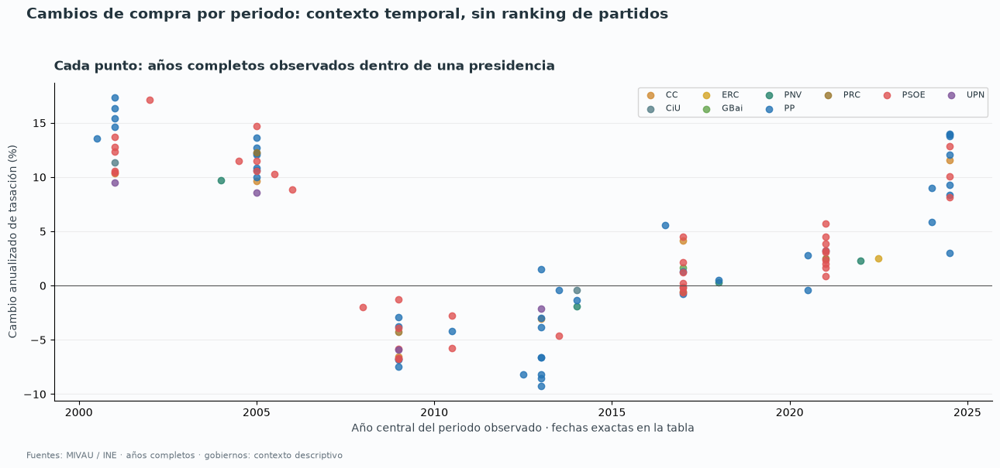

[Tabla completa de periodos y cambios](tables/block01/regional_mandate_changes.csv).
No se agregan comunidades y etapas en un ranking causal de partidos. Para establecer
si una política causó un cambio harán falta medidas concretas y un diseño comparativo.

## 7. Provincias y municipios

La fuente fiscal incluye **2555 municipios con datos
de alquiler en 2024**. Los mapas provinciales utilizan todas las observaciones
comparables disponibles. Los mapas municipales geolocalizan los 30 casos seleccionados
con CartoCiudad, verificando que el código INE devuelto coincide con el previsto.
Las tasaciones municipales se obtienen de la tabla del ministerio para municipios
mayores de 25.000 habitantes; no se repite un valor provincial como si fuera municipal.

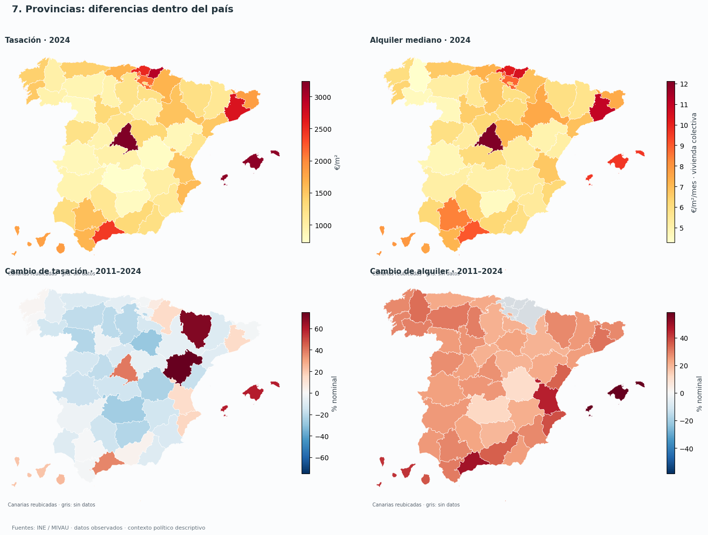
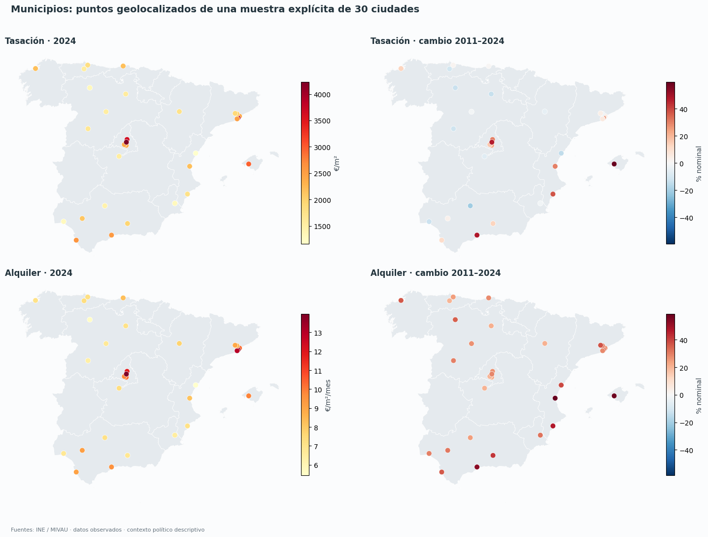
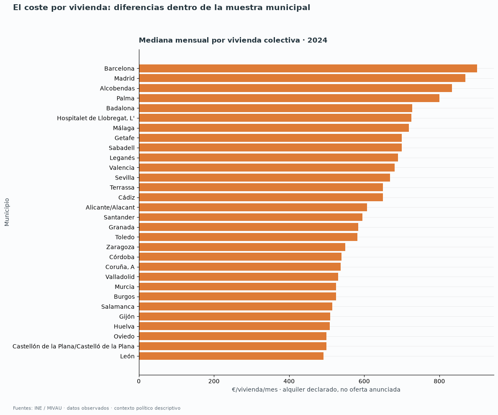
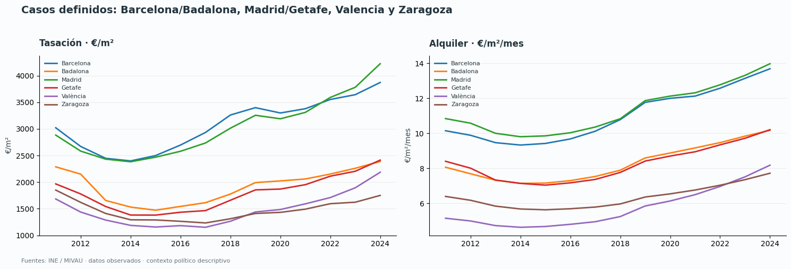

Los importes por vivienda son medianas de alquiler declarado de vivienda colectiva.
Una mediana por vivienda depende de la superficie y composición del parque: no basta
para concluir que el precio por m² es mayor en el mismo grado.

## 8. Lectura política de los resultados

Este bloque establece **cuándo, cuánto y dónde** cambian los precios. No contrasta aún
causas como turismo, falta de construcción, concentración de propiedad o efectos de
leyes. Ninguno de esos mecanismos queda probado únicamente por coincidir con un gobierno.

**Dirección observada del cambio por partido de la presidencia autonómica:**

| Presidencia | Intervalos | Compra sube | Compra baja | Alquiler sube | Alquiler baja |
| --- | --- | --- | --- | --- | --- |
| CC | 2 | 1 | 1 | 1 | 1 |
| CiU | 1 | 1 | 0 | 0 | 1 |
| ERC | 1 | 1 | 0 | 1 | 0 |
| PP | 20 | 11 | 9 | 9 | 11 |
| PRC | 2 | 2 | 0 | 2 | 0 |
| PSOE | 17 | 16 | 1 | 16 | 1 |

Se cuentan intervalos de territorios, no viviendas, votantes ni mandatos completos.
La cobertura y duración son desiguales: esta tabla permite revisar afirmaciones
absolutas como «solo sube bajo un partido», pero no mide qué partido lo hace mejor.
La adscripción de la presidencia tampoco identifica qué socios aprobaron una medida.

El alquiler de contratos nuevos crece **19.30%**
en 2021–2024, frente a **7.49%** en
contratos existentes. Es una diferencia importante para interpretar discursos que
mezclan la situación de quien busca vivienda con la de quien conserva un contrato.

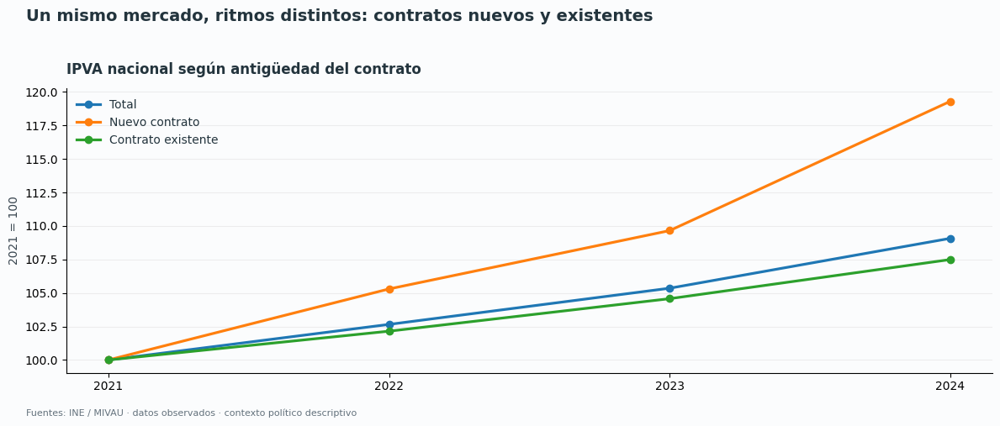

## Fuentes, reproducción y límites

- INE: IPV (tabla 79563), IPVA (59004) e IPC general (50913).
- MIVAU: valor tasado libre por m²; SERPAVI 2011–2024, vivienda colectiva, medianas;
  transacciones de segunda mano por vivienda y tasaciones municipales.
- Senado: dosieres históricos de presidentes autonómicos; BOE y Moncloa para contexto nacional.
- CartoCiudad (IGN): posiciones de los municipios seleccionados.
- Code for Germany / Click That 'Hood: límites de comunidades y provincias, simplificados
  para ilustración; geometrías fechadas en 2014. Se unen por códigos oficiales, no
  por el atributo autonómico del fichero provincial, cuya codificación es diferente.

Los promedios anuales de tasación son medias simples de cuatro trimestres; no están
ponderados por número de tasaciones. Las medianas fiscales cambian con la composición
del parque declarado y no son índices de precio constante ni anuncios de nuevos alquileres.
Los precios están separados por concepto. Se eliminan duplicados exactos del fichero
original de tasaciones de Navarra antes
de comprobar que hay cuatro trimestres distintos; se rechazan valores contradictorios.
No se extrapolan 2026 parcial ni cobertura
fiscal ausente. Los gráficos políticos son descriptivos, sin controles ni estimación causal.

Ejecutar desde la raíz: `python scripts/run_block01.py`. El notebook también reproduce
las figuras con los snapshots versionados, sin descargar 71 MB durante cada ejecución.
Para reconstruir desde las publicaciones originales: `python scripts/build_block01_data.py`
El script recupera también los registros políticos y la selección geográfica documentados.
Las URL y SHA-256 de los ficheros se conservan en el manifiesto.

- [valuations.csv](https://cdn.mivau.gob.es/portal-web-mivau/Datos_MIVAU/CSV/VDP006_01.csv)
- [rent.xlsx](https://cdn.mivau.gob.es/portal-web-mivau/vivienda/serpavi/2026-03_09_bd_SERPAVI_2011-2024%20-%20DEFINITIVO%20WEB_v2.xlsx)
- [ipv_quarterly.csv](https://www.ine.es/jaxiT3/files/t/csv_bdsc/79563.csv)
- [ipva.csv](https://www.ine.es/jaxiT3/files/t/csv_bdsc/59004.csv)
- [cpi.csv](https://www.ine.es/jaxiT3/files/t/csv_bdsc/50913.csv)
- [municipal_purchase.xls](https://apps.fomento.gob.es/BoletinOnline2/sedal/35103500.XLS)
- [purchase_total.xls](https://apps.fomento.gob.es/BoletinOnline2/sedal/34020170.XLS)
- [communities.geojson](https://raw.githubusercontent.com/codeforgermany/click_that_hood/main/public/data/spain-communities.geojson)
- [provinces.geojson](https://raw.githubusercontent.com/codeforgermany/click_that_hood/main/public/data/spain-provinces.geojson)
- [governments/01.html](https://www.senado.es/web/conocersenado/biblioteca/dossieresareastematicas/detalle/index.html?id=presidentes_gobiernos_01&lang=es_ES)
- [governments/02.html](https://www.senado.es/web/conocersenado/biblioteca/dossieresareastematicas/detalle/index.html?id=presidentes_gobiernos_02&lang=es_ES)
- [governments/03.html](https://www.senado.es/web/conocersenado/biblioteca/dossieresareastematicas/detalle/index.html?id=presidentes_gobiernos_03&lang=es_ES)
- [governments/04.html](https://www.senado.es/web/conocersenado/biblioteca/dossieresareastematicas/detalle/index.html?id=presidentes_gobiernos_04&lang=es_ES)
- [governments/05.html](https://www.senado.es/web/conocersenado/biblioteca/dossieresareastematicas/detalle/index.html?id=presidentes_gobiernos_05&lang=es_ES)
- [governments/06.html](https://www.senado.es/web/conocersenado/biblioteca/dossieresareastematicas/detalle/index.html?id=presidentes_gobiernos_06&lang=es_ES)
- [governments/07.html](https://www.senado.es/web/conocersenado/biblioteca/dossieresareastematicas/detalle/index.html?id=presidentes_gobiernos_07&lang=es_ES)
- [governments/08.html](https://www.senado.es/web/conocersenado/biblioteca/dossieresareastematicas/detalle/index.html?id=presidentes_gobiernos_08&lang=es_ES)
- [governments/09.html](https://www.senado.es/web/conocersenado/biblioteca/dossieresareastematicas/detalle/index.html?id=presidentes_gobiernos_09&lang=es_ES)
- [governments/10.html](https://www.senado.es/web/conocersenado/biblioteca/dossieresareastematicas/detalle/index.html?id=presidentes_gobiernos_10&lang=es_ES)
- [governments/11.html](https://www.senado.es/web/conocersenado/biblioteca/dossieresareastematicas/detalle/index.html?id=presidentes_gobiernos_11&lang=es_ES)
- [governments/12.html](https://www.senado.es/web/conocersenado/biblioteca/dossieresareastematicas/detalle/index.html?id=presidentes_gobiernos_12&lang=es_ES)
- [governments/13.html](https://www.senado.es/web/conocersenado/biblioteca/dossieresareastematicas/detalle/index.html?id=presidentes_gobiernos_13&lang=es_ES)
- [governments/14.html](https://www.senado.es/web/conocersenado/biblioteca/dossieresareastematicas/detalle/index.html?id=presidentes_gobiernos_14&lang=es_ES)
- [governments/15.html](https://www.senado.es/web/conocersenado/biblioteca/dossieresareastematicas/detalle/index.html?id=presidentes_gobiernos_15&lang=es_ES)
- [governments/16.html](https://www.senado.es/web/conocersenado/biblioteca/dossieresareastematicas/detalle/index.html?id=presidentes_gobiernos_16&lang=es_ES)
- [governments/17.html](https://www.senado.es/web/conocersenado/biblioteca/dossieresareastematicas/detalle/index.html?id=presidentes_gobiernos_17&lang=es_ES)
- [cities/08019.json](https://www.cartociudad.es/geocoder/api/geocoder/find?q=Barcelona%2C+Barcelona)
- [cities/28079.json](https://www.cartociudad.es/geocoder/api/geocoder/find?q=Madrid%2C+Madrid)
- [cities/46250.json](https://www.cartociudad.es/geocoder/api/geocoder/find?q=Valencia%2C+Valencia)
- [cities/29067.json](https://www.cartociudad.es/geocoder/api/geocoder/find?q=M%C3%A1laga%2C+M%C3%A1laga)
- [cities/50297.json](https://www.cartociudad.es/geocoder/api/geocoder/find?q=Zaragoza%2C+Zaragoza)
- [cities/41091.json](https://www.cartociudad.es/geocoder/api/geocoder/find?q=Sevilla%2C+Sevilla)
- [cities/07040.json](https://www.cartociudad.es/geocoder/api/geocoder/find?q=Palma%2C+Illes+Balears)
- [cities/03014.json](https://www.cartociudad.es/geocoder/api/geocoder/find?q=Alicante%2C+Alicante)
- [cities/47186.json](https://www.cartociudad.es/geocoder/api/geocoder/find?q=Valladolid%2C+Valladolid)
- [cities/18087.json](https://www.cartociudad.es/geocoder/api/geocoder/find?q=Granada%2C+Granada)
- [cities/14021.json](https://www.cartociudad.es/geocoder/api/geocoder/find?q=C%C3%B3rdoba%2C+C%C3%B3rdoba)
- [cities/30030.json](https://www.cartociudad.es/geocoder/api/geocoder/find?q=Murcia%2C+Murcia)
- [cities/15030.json](https://www.cartociudad.es/geocoder/api/geocoder/find?q=A+Coru%C3%B1a%2C+A+Coru%C3%B1a)
- [cities/39075.json](https://www.cartociudad.es/geocoder/api/geocoder/find?q=Santander%2C+Cantabria)
- [cities/33024.json](https://www.cartociudad.es/geocoder/api/geocoder/find?q=Gij%C3%B3n%2C+Asturias)
- [cities/33044.json](https://www.cartociudad.es/geocoder/api/geocoder/find?q=Oviedo%2C+Asturias)
- [cities/08015.json](https://www.cartociudad.es/geocoder/api/geocoder/find?q=Badalona%2C+Barcelona)
- [cities/08101.json](https://www.cartociudad.es/geocoder/api/geocoder/find?q=Hospitalet+de+Llobregat%2C+Barcelona)
- [cities/08279.json](https://www.cartociudad.es/geocoder/api/geocoder/find?q=Terrassa%2C+Barcelona)
- [cities/08187.json](https://www.cartociudad.es/geocoder/api/geocoder/find?q=Sabadell%2C+Barcelona)
- [cities/28065.json](https://www.cartociudad.es/geocoder/api/geocoder/find?q=Getafe%2C+Madrid)
- [cities/28074.json](https://www.cartociudad.es/geocoder/api/geocoder/find?q=Legan%C3%A9s%2C+Madrid)
- [cities/28006.json](https://www.cartociudad.es/geocoder/api/geocoder/find?q=Alcobendas%2C+Madrid)
- [cities/45168.json](https://www.cartociudad.es/geocoder/api/geocoder/find?q=Toledo%2C+Toledo)
- [cities/09059.json](https://www.cartociudad.es/geocoder/api/geocoder/find?q=Burgos%2C+Burgos)
- [cities/24089.json](https://www.cartociudad.es/geocoder/api/geocoder/find?q=Le%C3%B3n%2C+Le%C3%B3n)
- [cities/37274.json](https://www.cartociudad.es/geocoder/api/geocoder/find?q=Salamanca%2C+Salamanca)
- [cities/11012.json](https://www.cartociudad.es/geocoder/api/geocoder/find?q=C%C3%A1diz%2C+C%C3%A1diz)
- [cities/21041.json](https://www.cartociudad.es/geocoder/api/geocoder/find?q=Huelva%2C+Huelva)
- [cities/12040.json](https://www.cartociudad.es/geocoder/api/geocoder/find?q=Castell%C3%B3n+de+la+Plana%2C+Castell%C3%B3n)
