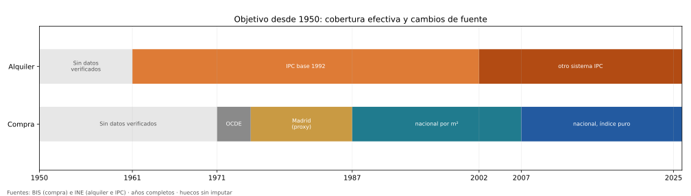
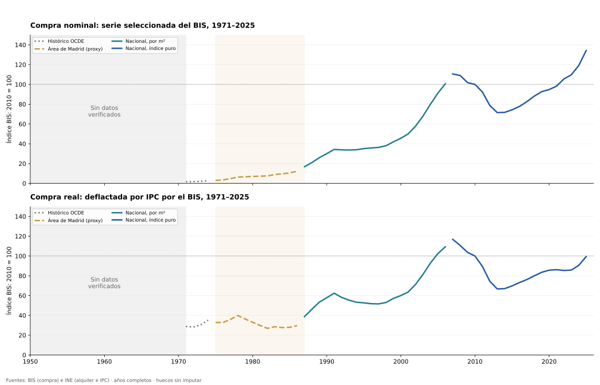
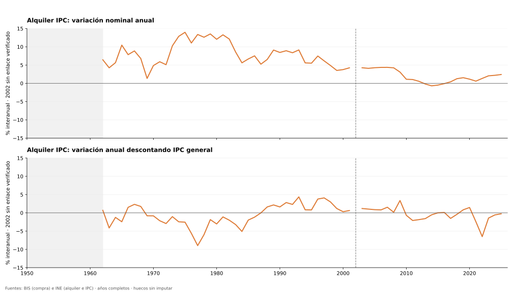
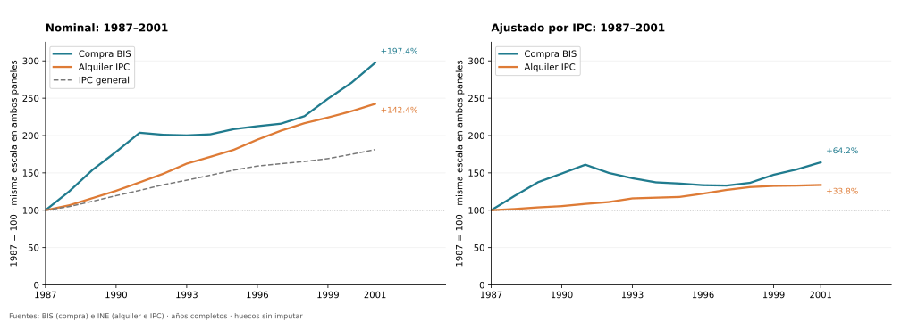
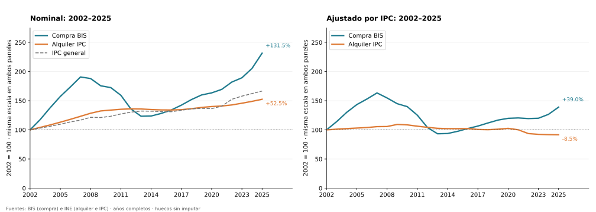

# Vivienda desde 1950: horizonte histórico y datos efectivamente recuperados

**1950 es el inicio solicitado del análisis, no el primer dato disponible.** La cobertura
verificada empieza en 1961 para alquiler e IPC y en 1971 para la serie seleccionada de compra.
Se publican los años vacíos desde 1950. No son ceros, ni precios constantes, ni estimaciones.

## Compra: 1971–2025, con cambios de cobertura

Fuente: [BIS, series seleccionadas](https://data.bis.org/topics/RPP). El tramo 1971–1974 usa
estadísticas históricas de la OCDE; 1975–1986 usa precios del área de Madrid; 1987–2006,
precios nacionales por m²; desde 2007, índice nacional de precios puro. El proxy madrileño
se dibuja discontinuo y diferenciado. La frecuencia trimestral histórica puede incluir
interpolaciones del proveedor. No se trata de una medición nacional homogénea desde 1971.

Los índices nominales y reales mantienen la base BIS 2010 = 100 y una escala vertical común.
Son índices, no €/m² o €/vivienda. El índice real oficial BIS utiliza el IPC; las comparaciones
por periodo de abajo deflactan las medias anuales con el mismo IPC anual para compra y alquiler.

## Alquiler: recuperación real desde 1961

Se recuperaron los índices mensuales históricos del INE (tabla 196, alquiler; tabla 268,
IPC general), 1961–2001. Se verificó la media anual de alquiler contra la tabla 203.
Desde 2002 se usan las tablas 24079 y 24077. Se exigen doce meses observados para cada año.

La base 1992 y el sistema posterior a 2002 se conservan por separado. El INE documenta una
ruptura metodológica en 2002: [enlace legal](https://www.ine.es/ipc01/enlaces.htm).
No se ha verificado un coeficiente de enlace para estas extracciones: el cambio anual de 2002
queda vacío y no se calcula un cambio acumulado entre ambos sistemas.

El alquiler de esta sección es el **componente de alquiler del IPC**, distinto del **IPVA**
fiscal usado en la comparación 2011–2024. No se sustituyen ni se mezclan ambos indicadores.
El IPC de alquiler no representa el precio anunciado ni exclusivamente contratos nuevos.

## Comparaciones nacionales dentro de periodos coherentes

Compra se compara desde 1987 para evitar usar Madrid como si representara toda España.
Ambas series tienen la misma ventana, base y deflactor dentro de cada comparación.
Cada par nominal/real comparte exactamente su escala vertical. Las dos ventanas tienen
bases y duraciones diferentes: sus porcentajes no constituyen un ranking entre periodos.

| Periodo | Medida | Cambio nominal | Cambio real |
| --- | --- | ---: | ---: |
| 1987–2001 | Compra BIS | +197.38% | +64.15% |
| 1987–2001 | Alquiler IPC | +142.43% | +33.82% |
| 2002–2025 | Compra BIS | +131.53% | +39.00% |
| 2002–2025 | Alquiler IPC | +52.49% | -8.45% |

El resultado 2011–2024 del [análisis reciente](block_01_price_history.md) no describe
lo ocurrido desde 1950. El cambio de año inicial y de indicador modifica la pregunta.
Deflactar precios tampoco mide accesibilidad: para eso se requieren ingresos coherentes.

## Qué sigue sin estar verificado

- Compra nacional comparable 1950–1970 y alquiler nacional 1950–1960.
- Enlace cuantitativo del alquiler entre 2001 y 2002.
- Datos anuales originales de la reconstrucción académica 1959–1986: se localizó el
  [estudio de Taltavull y Juárez (2015)](https://recyt.fecyt.es/index.php/CyTET/article/view/76437),
  pero no se incorporan precios modelados que no se hayan extraído y validado.

La búsqueda incluyó archivos del INE, documentación del Banco de España, BIS e investigación.
Esto delimita lo recuperado, no demuestra que no existan otras fuentes históricas.

## Reproducción

- [Notebook con código y resultados](../notebooks/01c_prices_since_1950.ipynb).
- [Cobertura anual 1950–2025 y tablas](tables/since1950/).
- [Fuentes originales y SHA-256](../data/snapshots/history1950/source_manifest.json).
- [Metodología y atribución](../data/snapshots/history1950/README.md).

`python scripts/run_history1950.py` reproduce cinco figuras y las tablas sin internet.
`python scripts/build_history1950_data.py` vuelve a extraer las fuentes originales.
