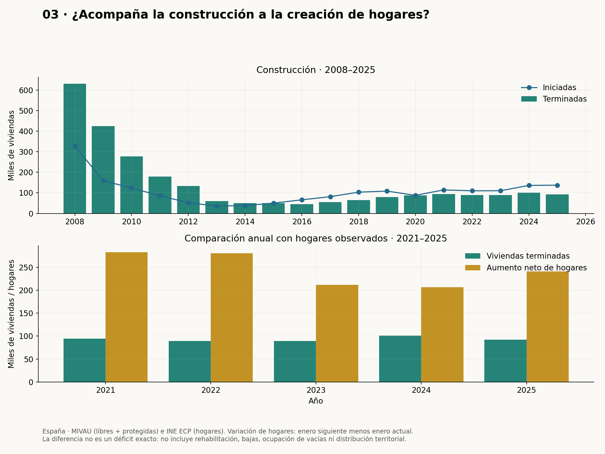
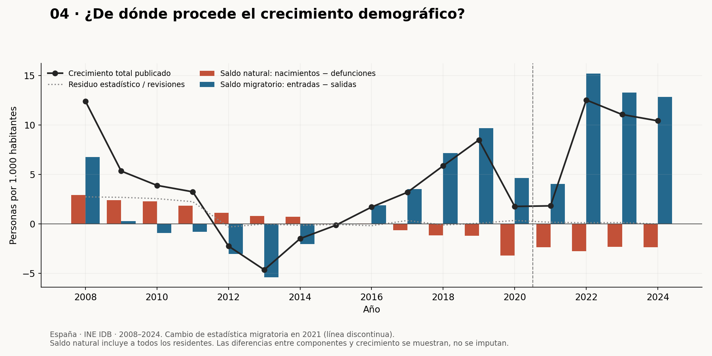
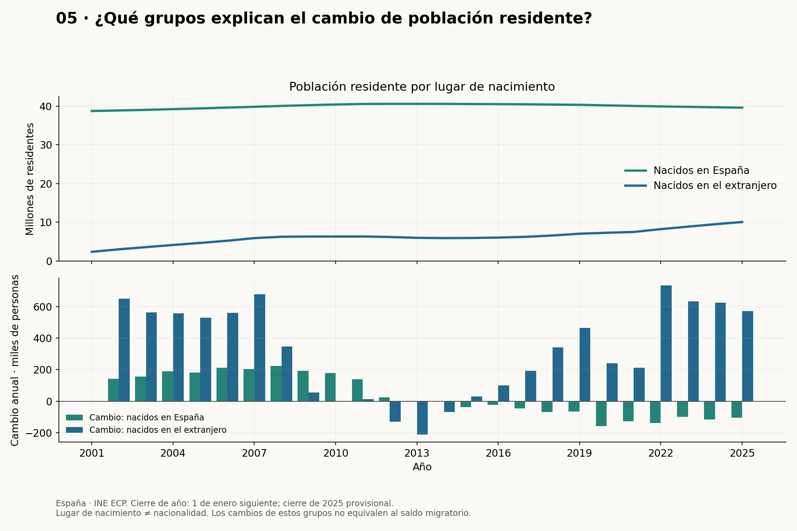

# Demografía, construcción y precio de la vivienda

Fuentes oficiales recuperadas el 6 de octubre de 2026. [Notebook ejecutado](../notebooks/02_demographics.ipynb) · [Metodología](../docs/block_02_demographics.md) · [Fuentes y hashes](../data/snapshots/block02/source_manifest.json).

## Qué muestran los datos

Entre 2001 y 2025, la tasación nominal aumentó un **120.0%**, la población un **20.9%**, los adultos un **23.9%** y el parque un **28.8%**. El parque creció más que la población en todo el periodo: no se sostiene que siempre se haya quedado atrás. Las ratios por habitante y adulto sí descienden en el tramo reciente. El precio nominal no mide accesibilidad ni descuenta inflación.

Durante 2021–2025 se formaron **1,222,836 hogares netos** y se terminaron **466,469 viviendas**. Su diferencia es **756,367**. Indica un desajuste entre estos flujos; no es un recuento exacto de viviendas que faltan. No se añaden rehabilitaciones ni se restan bajas, y no se considera la ocupación de viviendas existentes ni su localización.

En 2024, el saldo natural fue **−2,37** y el migratorio **+12,81 personas por 1.000 habitantes**. El crecimiento publicado fue +10,41 y el residuo de las series −0,03. El saldo migratorio positivo compensa el negativo natural; esta contabilidad no mide cuánto sube el precio por esa migración.

Durante 2025, con cierre provisional al 1 de enero de 2026, los residentes nacidos en España cambiaron en **-104,599** y los nacidos en el extranjero en **+572,678**. Son variaciones de grupos de población, distintas del saldo migratorio. Lugar de nacimiento no equivale a nacionalidad.

## Seis figuras

### Crecimiento acumulado con base común

### Viviendas por habitante y por adulto

### Construcción y nuevos hogares

### Componentes del crecimiento demográfico

### Población por lugar de nacimiento

### Comparación regional con mismos extremos y escala

## Alcance de las conclusiones

Se construyen viviendas, pero en 2021–2025 las terminadas son inferiores a la creación neta de hogares observada. La comparación demográfica respalda que la migración exterior contribuye al crecimiento reciente; no permite atribuirle por sí sola el encarecimiento de la vivienda.

El parque nacional incluye viviendas ocupadas, secundarias y vacías. Población estable puede coexistir con nuevos hogares por cambios en su tamaño. La media nacional puede ocultar desajustes locales. No se estiman efectos causales ni se evalúa gestión partidista.

La población y el lugar de nacimiento al cierre de 2025 son provisionales. Las fuentes de hogares y vivienda pueden revisarse. La serie de hogares empieza en enero de 2021; no se interpola hacia 2000. Las tasas migratorias cambian de estadística en 2021 y esta ruptura se marca. Pequeños residuos históricos por nacimiento se conservan.

## Tablas y reproducción

[Panel anual](tables/block02/annual_panel.csv), [lugar de nacimiento](tables/block02/birthplace.csv), [componentes demográficos](tables/block02/growth_components.csv), [comparación regional](tables/block02/regional_comparison.csv) y [resumen numérico](tables/block02/findings.json).

Ejecutar `python scripts/run_block02.py` desde la raíz del proyecto. Los snapshots están versionados y la reproducción no requiere red.
